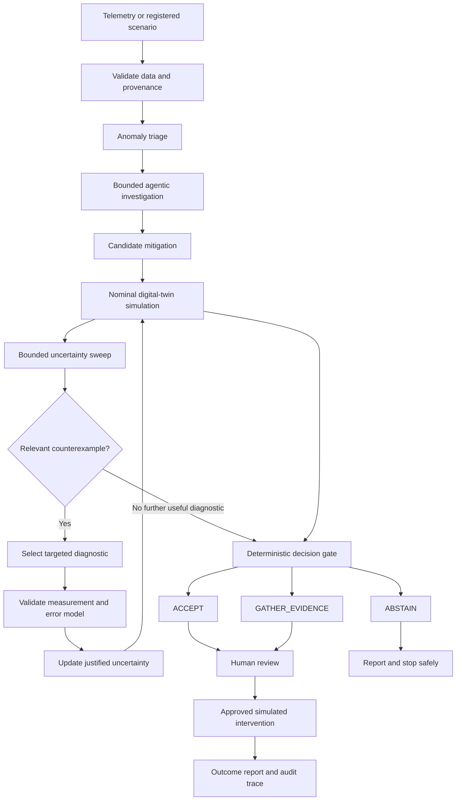
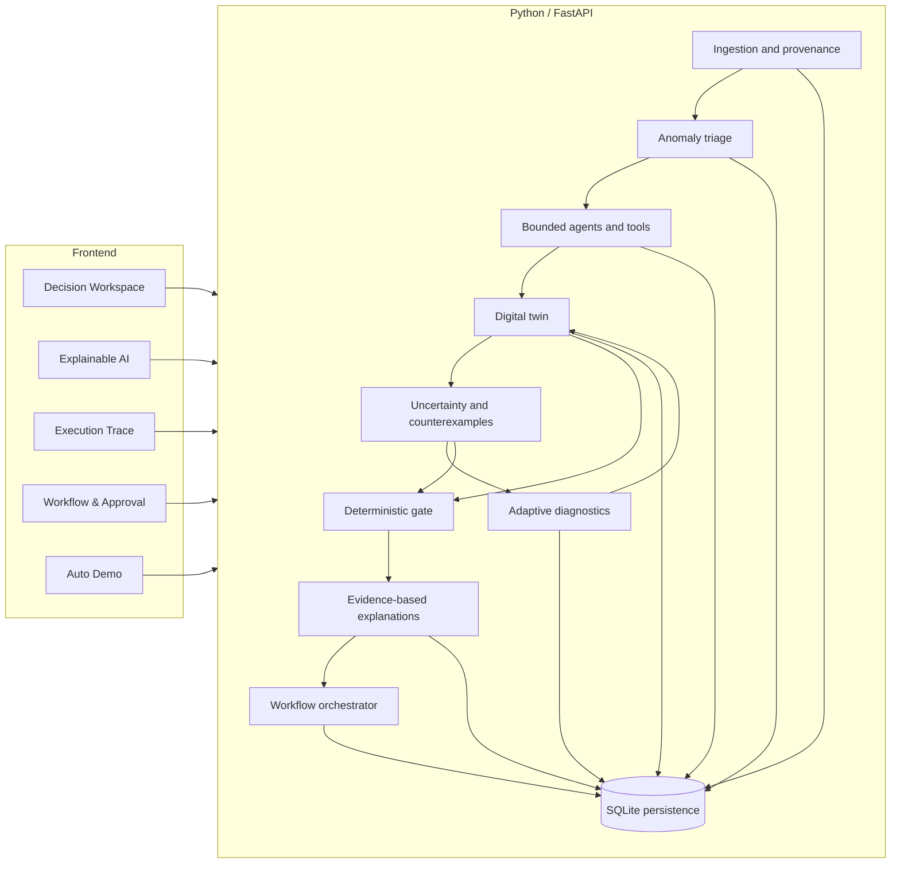

 <div align="center">

# FidelityGate

### Counterexample-Guided Decision Assurance for Agentic Network Operations

**Make every network decision earn its confidence.**

[](https://www.python.org/)
[](https://fastapi.tiangolo.com/)
[](https://nextjs.org/)
[](https://www.typescriptlang.org/)
[](#the-problem)
[](#responsible-use)

*An evidence-driven engineering prototype for evaluating AI-assisted network interventions under model uncertainty.*

</div>

---

## Overview

A digital twin can predict that a network reroute will satisfy a service-level objective under nominal conditions. But what happens when the assumptions behind that prediction are wrong?

**FidelityGate investigates whether a proposed network intervention remains justified when the model is uncertain.**

Instead of trusting an agent's recommendation or relying only on a single nominal prediction, FidelityGate combines deterministic network simulation, bounded uncertainty analysis, counterexample discovery, targeted diagnostic measurements, and evidence-based decision rules.

The system is designed to distinguish a plausible recommendation from a sufficiently supported decision.

### The principle

> Agents investigate and recommend. Deterministic software calculates and enforces. An independent evaluator measures. A human authorizes consequential actions.

**Primary domain:** IT Infrastructure  
**Business use case:** Human-approved network-reroute assurance during a traffic surge  
**Execution boundary:** Isolated digital-twin simulation; no production router configuration

## The problem

Imagine a network reroute that appears feasible under the nominal model but fails when a plausible parameter variation exposes a hidden constraint violation.

A confident AI recommendation is not enough. A conventional fixed margin may also be either unnecessarily conservative or insufficiently protective.

FidelityGate explores three questions:

1. Under which plausible conditions does the candidate fail?
2. Which diagnostic measurement could resolve a decision-relevant uncertainty?
3. Does the resulting evidence justify proceeding, gathering more evidence, or abstaining?

## The workflow



The adaptive loop is bounded by the configured diagnostic budget, simulation budget, timeout, and available measurement models. A finite uncertainty sweep provides evidence about the tested envelope; it does not prove universal safety.

## What makes FidelityGate different?

| Capability | Purpose |
|---|---|
| **Counterexample-guided validation** | Finds tested parameter configurations that violate candidate constraints. |
| **Targeted diagnostics** | Prioritizes measurements relevant to a decision blocker rather than repeatedly collecting unrelated evidence. |
| **Measurement-aware uncertainty updates** | Updates only parameters justified by a valid observation model, compatible units, and declared error bounds. |
| **Deterministic decision gate** | Applies explicit policy checks independently of the agent's confidence or free-form explanation. |
| **Evidence-based XAI** | Connects explanations to stored findings, measurements, constraints, counterexamples, and gate results. |
| **Human authorization** | Keeps approval separate from the software gate verdict. |
| **Persistent audit history** | Retains workflow identities, events, evidence references, and simulated outcome records where implemented. |

The contribution is not the use of agents or a digital twin in isolation. It is the combination of counterexample-guided evidence acquisition, measurement-aware reevaluation, and an independent deterministic gate.

## Architecture

FidelityGate uses a modular-monolith architecture: a Python/FastAPI backend owns the domain logic, while a Next.js, React, and TypeScript frontend presents the operational workflow.



### Implementation layers

<details>
<summary><strong>Layer 1 — Trustworthy ingestion and provenance</strong></summary>

The ingestion layer validates supported network telemetry, normalizes timestamps and units, records source provenance, and quarantines malformed records. Source-defined labels are kept distinct from detector-inferred findings.

Key area: `fidelitygate/ingestion/`

</details>

<details>
<summary><strong>Layer 2 — Anomaly triage and evidence correlation</strong></summary>

Deterministic detectors identify robust deviations and step changes. Correlation groups related observations using entity and temporal proximity while avoiding unsupported causal claims.

Key area: `fidelitygate/triage/`

</details>

<details>
<summary><strong>Layer 3 — Bounded agentic investigation</strong></summary>

Specialist agent roles interpret structured findings, formulate evidence-linked hypotheses, and propose diagnostics or candidate mitigations through allowlisted tools. Invalid or insufficient evidence can produce a controlled failure rather than an invented conclusion.

Key area: `fidelitygate/investigation/`

</details>

<details>
<summary><strong>Layer 4 — Digital-twin evaluation and counterexamples</strong></summary>

Candidate paths are validated against registered topology and flow constraints before simulation. The uncertainty evaluator explores a bounded parameter envelope and preserves tested configurations that violate constraints.

Key area: `fidelitygate/evaluation/`

</details>

<details>
<summary><strong>Layer 5 — Adaptive diagnostics</strong></summary>

When further evidence may change the decision, the diagnostic selector chooses from a registered catalog. The measurement is validated against its declared error model, justified uncertainty is updated, and the affected candidate is reevaluated.

Key area: `fidelitygate/adaptive/`

</details>

<details>
<summary><strong>Layer 6 — Evidence-based explainability</strong></summary>

The explanation layer derives rule explanations, counterexample descriptions, diagnostic summaries, and local sensitivity results from structured records. It does not have authority to change the decision gate's verdict.

Key area: `fidelitygate/xai/`

</details>

<details>
<summary><strong>Layer 7 — Workflow, approval and outcome reporting</strong></summary>

The workflow orchestrator connects the investigation, evaluation, explanation, human approval, simulated intervention, and outcome report through persistent workflow records and audit events.

Key area: `fidelitygate/workflow/`

</details>

<details>
<summary><strong>Frontend — Operational workspace and guided demo</strong></summary>

The Next.js application includes the decision workspace, Workflow & Approval, XAI, execution trace, metrics, evaluation, run history, settings, user guide, and guided Auto Demo components.

The Auto Demo guides navigation through the selected workflow; it must not fabricate results or authorize actions automatically.

Key area: `src/`

</details>

## Mathematical model

For a directed network graph \(G=(V,E)\), define:

- \(C_e\): capacity of edge \(e\)
- \(b_e\): background load on edge \(e\)
- \(q_k\): demand of flow \(k\)
- \(x_{ke}\): indicator that flow \(k\) uses edge \(e\)

The simulated edge load and utilization are:

\[
B_e=b_e+\sum_k q_kx_{ke},
\qquad
\rho_e=\frac{B_e}{C_e}.
\]

A simplified queueing-inspired delay approximation used in the project methodology is:

\[
Q(\rho)=\frac{0.15\rho}{\max(1-\rho,0.05)}.
\]

This approximation captures increasing delay as utilization approaches capacity, but it is **not a calibrated production-network queueing model**. Outputs depend on the registered topology, traffic demands, capacity assumptions, and the chosen model parameters.

### Measurement-aware uncertainty

For a direct bounded-error measurement of parameter \(\theta\), a simple interval update is:

\[
\Theta_{\text{new}}
=
\Theta_{\text{old}}\cap[y-\delta,y+\delta].
\]

This update is appropriate only when the measurement \(y\), error bound \(\delta\), and target parameter use compatible units and the measurement model justifies the direct relationship.

For an observation model of the form \(y=h(\theta)+\epsilon\), the observation constraints must be mapped back into the parameter domain. Raw measurement intervals must not be intersected with parameter intervals representing different quantities.

## Evaluation methodology

FidelityGate is designed to be compared against simpler approaches using consistent initial information, declared thresholds, and controlled scenarios.

| Method | Question |
|---|---|
| **Nominal-only** | What happens when a decision uses a single nominal prediction? |
| **Fixed safety margin** | How does a static conservative margin behave? |
| **Non-adaptive uncertainty sweep** | What does a bounded sweep reveal without targeted evidence acquisition? |
| **Adaptive FidelityGate** | Does targeted measurement and reevaluation improve decisions under the declared evaluation protocol? |

Useful metrics include:

- Unsafe-acceptance frequency.
- False-abstention rate.
- Correct decision count.
- Diagnostic calls.
- Simulation evaluations.
- End-to-end latency.

Report actual numerators, denominators, scenario-set identifiers, seeds, and data modes. The test-suite pass count is not a substitute for a comparative benchmark. Claims of superiority or statistical significance require actual evaluation results.

## Data sources and provenance

The project uses explicit data-mode labels where supported by the actual pipeline:

- `PUBLIC_DATA`
- `REPLAY`
- `SYNTHETIC_FIXTURE`
- `SYNTHETIC_FAULT_INJECTION`
- `SIMULATED`
- `UNKNOWN`

Public telemetry can contain interface counters and queue-related measurements without providing complete topology, end-to-end latency, capacity, or intervention ground truth. Missing information must not be presented as a physical measurement.

Synthetic scenarios are useful for controlled simulation and testing, but their results must remain labelled as synthetic or simulated.

## Responsible-use boundary

- The current intervention path is simulation-only.
- Agents cannot override the deterministic decision gate.
- `ABSTAIN` remains a valid result when evidence is insufficient or mandatory constraints fail.
- Human approval is distinct from the gate's decision.
- Hidden reference truth must remain isolated from agent-accessible tools.
- Finite uncertainty sweeps do not guarantee safety outside the tested parameter envelope.
- Results apply to the scenarios and models evaluated so far.

## Interface and demonstration

The application is intended to provide a single workflow with linked evidence and persistent results.

| Workspace section | Purpose |
|---|---|
| **Decision Workspace / Topology** | Inspect scenario and candidate context. |
| **Workflow & Approval** | Follow execution, inspect the gate result, and review the authorization boundary. |
| **Explainable AI** | Examine rules, counterexamples, measurements, sensitivity and provenance where available. |
| **Execution Trace** | Inspect persisted workflow events where available. |
| **Metrics / Evaluation Lab** | Review actual metrics and benchmark outputs where available. |
| **Audit Runs** | Reopen persisted execution records. |
| **Auto Demo** | Navigate through the selected workflow without auto-approving actions. |

A missing artifact should be displayed as unavailable, not replaced with a fabricated success state.

### Recommended demo sequence

1. Start the application and confirm backend health.
2. Select or load a supported scenario.
3. Start or open a persisted workflow.
4. Inspect the candidate evaluation and counterexample if one exists.
5. Review the diagnostic and uncertainty update where available.
6. Inspect the XAI explanation and authoritative gate verdict.
7. Make any approval decision manually.
8. Review the persisted simulated outcome.
9. Use Auto Demo to navigate the relevant workspace sections.

Do not describe an existing persisted run as a newly executed live run.

## Getting started

### Prerequisites

- Node.js 18 or later
- Python 3.11 or later
- npm and pip

### Install dependencies

```bash
npm install
python -m venv .venv
```

Activate the Python environment.

**Windows PowerShell**

```powershell
.\.venv\Scripts\Activate.ps1
```

**macOS / Linux**

```bash
source .venv/bin/activate
```

Install backend dependencies:

```bash
pip install -r requirements.txt
```

### Configure the environment

Use the existing `.env.example` as a starting point for local configuration. Verify the actual required environment variables in the current repository. Never commit real API keys, tokens, passwords, local databases, or private credentials.

### Run locally

From the project root:

```bash
node start-dev.js
```

The startup script is intended to launch the local development stack.

- Frontend: <http://localhost:3000>
- Workspace: <http://localhost:3000/workspace>
- FastAPI backend: <http://127.0.0.1:8000>
- API documentation: <http://127.0.0.1:8000/docs>

Use the actual registered health endpoint when verifying backend readiness. If startup fails, inspect the terminal output and check whether ports 3000 and 8000 are occupied.

## Verification commands

Run the checks supported by the current repository:

```bash
python -m pytest tests/ -v
npx tsc --noEmit
npm run lint
npm run build
```

A passing test suite or build does not, by itself, establish full end-to-end operation. Verify the running browser workflow and compare the selected workflow's identifiers, gate verdict, approval and outcome against the backend records.

Consult `docs/TEST_REPORT.md` and `docs/CURRENT_STATUS.md` for recorded results, then verify those results in the current checkout before repeating claims in a release or presentation.

## Repository structure

```text
.
├── data/                  # Dataset manifests, processed data and reports
├── docs/                  # Architecture, methodology, contracts and status
├── fidelitygate/
│   ├── api/               # FastAPI application
│   ├── ingestion/         # Parsing, validation, provenance and quarantine
│   ├── triage/            # Anomaly detection and evidence correlation
│   ├── investigation/     # Bounded agents and allowlisted tools
│   ├── evaluation/        # Digital twin and counterexample evaluation
│   ├── adaptive/          # Diagnostic selection and uncertainty updates
│   ├── xai/               # Evidence-based explanation
│   ├── workflow/          # Orchestration, approval and outcome reporting
│   ├── storage.py         # Persistence
│   ├── decision_gate.py   # Deterministic policy gate
│   └── cli.py             # CLI entry point
├── scripts/               # Dataset and workflow runners
├── src/                   # Next.js frontend
├── tests/                 # Automated tests and fixtures
├── start-dev.js           # Combined development launcher
├── package.json
└── requirements.txt
```

See the current source tree for exact module names and available commands.

## Alignment with judging criteria

| Criterion | FidelityGate's response | Evidence to show |
|---|---|---|
| **Reusability** | Modular ingestion, typed tools, registered scenarios and repeatable evaluation | Actual contracts, scenario configuration and reproducible commands |
| **Governance & responsibility** | Provenance, counterexamples, uncertainty, deterministic gate, abstention and human approval | One traceable workflow showing evidence and the approval boundary |
| **ROI / business value** | Intended to reduce unsupported interventions and focus diagnostics | Measured baseline comparisons or an explicit evaluation-pending status |
| **MVP readiness** | Local full-stack application with workflow, explanation and simulation capabilities | Verified browser demo, real backend responses and reproducible setup |
| **Originality & innovation** | Counterexample-guided diagnostic acquisition and measurement-aware reevaluation | A real counterexample → diagnostic → update → reevaluation trace |

Business savings and avoided incidents remain intended benefits until measured using representative operational data.

## Known limitations

- The digital twin is simplified and is not certified against a live production network.
- Parameter sweeps cover a finite, declared uncertainty envelope.
- Public telemetry may not contain all parameters needed for full network simulation.
- Synthetic scenarios and hidden reference truth belong to a controlled evaluation environment.
- The current workflow does not configure physical routers.
- Broader held-out evaluation and authorized shadow-mode validation are necessary before considering production deployment.
- SQLite is appropriate for a local prototype; a multi-instance deployment would require a deliberate persistence and concurrency strategy.

## Documentation

- [`docs/ARCHITECTURE.md`](docs/ARCHITECTURE.md) — architecture and data flow
- [`docs/CONTRACTS.md`](docs/CONTRACTS.md) — API and type contracts
- [`docs/METHODOLOGY.md`](docs/METHODOLOGY.md) — equations, assumptions and units
- [`docs/DATASETS.md`](docs/DATASETS.md) — provenance and dataset limitations
- [`docs/EVALUATION_PROTOCOL.md`](docs/EVALUATION_PROTOCOL.md) — evaluation methods and metrics
- [`docs/CURRENT_STATUS.md`](docs/CURRENT_STATUS.md) — implementation and verification status
- [`docs/TEST_REPORT.md`](docs/TEST_REPORT.md) — recorded test results
- [`docs/HANDOFF.md`](docs/HANDOFF.md) — project handoff and next steps

## Acknowledgements

Prepared for AgentOps '26, organized by the School of Computer Engineering, MIT Bengaluru, in collaboration with CGI.

<div align="center">

**FidelityGate**

*Investigate · Challenge · Measure · Verify · Authorize*

</div>