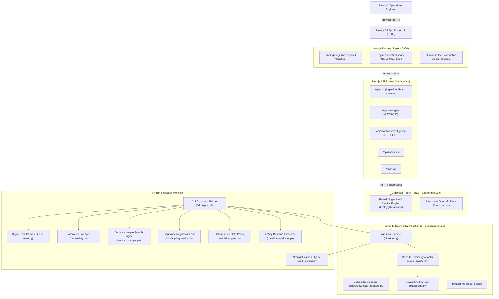
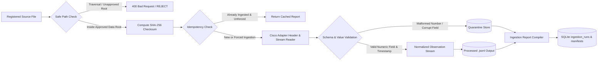
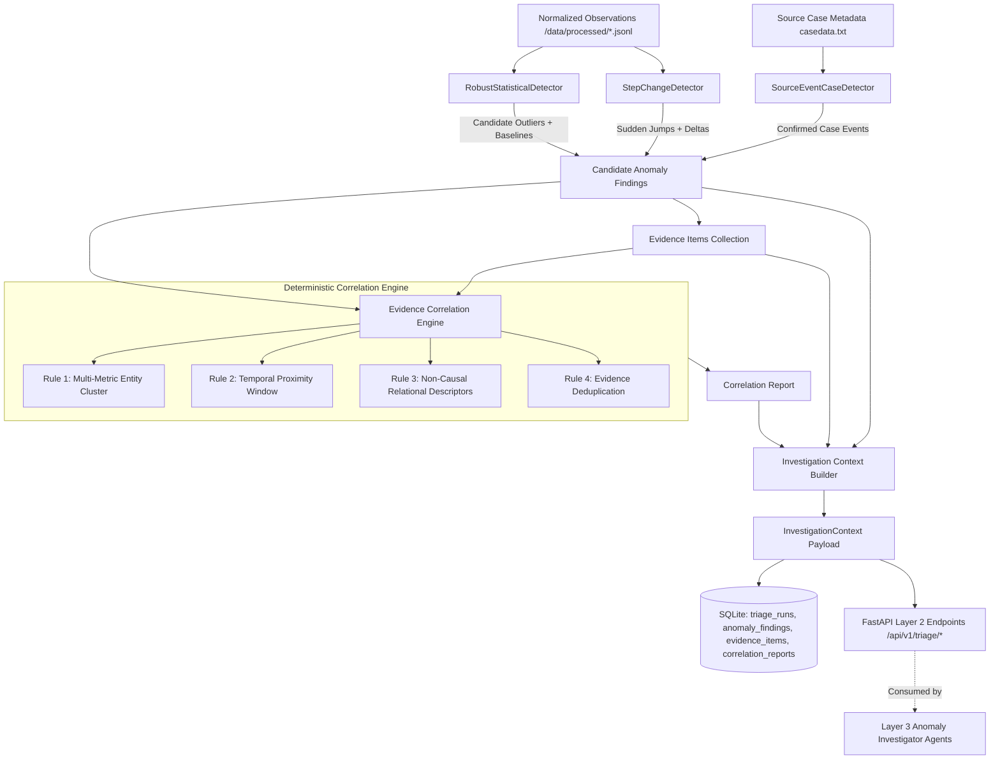
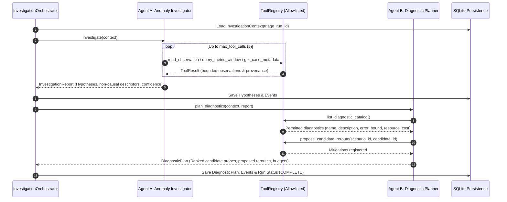
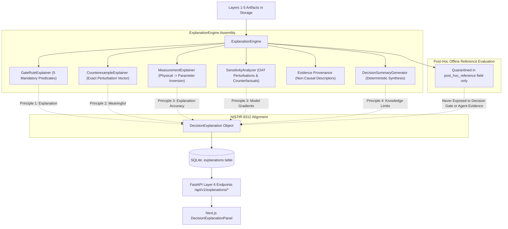
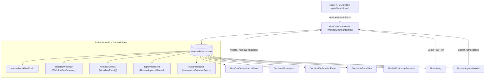
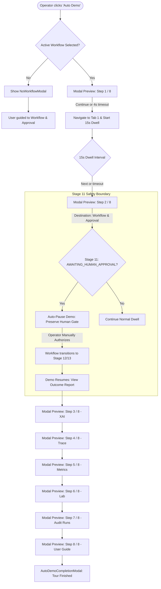
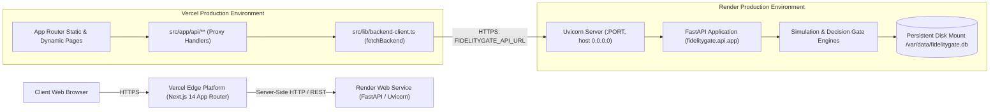

# FidelityGate — System Architecture & Data Flow

This document details the complete component hierarchy, runtime execution model, Layer 1 data ingestion engine, and API boundaries of FidelityGate.

---

## 1. System Block Diagram



---

## 2. Layer 1 Ingestion Pipeline Architecture

The ingestion pipeline enforces strict bounding, safe path containment, cryptographic checksum verification, schema normalization, and quarantine isolation:



### Ingestion Pipeline Stages

1. **Approved File Discovery & Path Containment**:
   All paths must resolve strictly within `data/raw/` or approved project test fixtures. Directory traversal attempts (`../`) and absolute filesystem paths outside configured roots are rejected with `HTTP 400 Bad Request` and `IngestionSecurityError`.
2. **SHA-256 Checksum Verification**:
   Source files are hashed in 64 KB binary chunks to produce a persistent, deterministic fingerprint.
3. **Idempotency Gate**:
   If a matching `source_checksum` and `dataset_version` exists in SQLite with status `SUCCESS` and `force_reingest=False`, the existing `IngestionReport` is returned immediately without duplicate computation.
4. **Adapter Schema Validation & Streaming**:
   The `CiscoTelemetryAdapter` parses CSV/CSV.GZ files, checks mandatory headers (`name`, `time`, `Producer`), and streams records directly to disk sinks to maintain $O(1)$ memory consumption.
5. **Quality Checks & Quarantine**:
   Malformed or unparseable numeric values are isolated into `data/quarantine/{ingestion_id}_quarantine.jsonl`. Monotonicity violations and duplicates generate structured `DataQualityIssue` warnings.
6. **Persistence & Manifest Store**:
   - Normalized observations: `data/processed/{ingestion_id}_normalized.jsonl`
   - Manifests: `data/manifests/{source_id}_manifest.json` and SQLite `dataset_manifests` table
   - Reports: `data/reports/{ingestion_id}_report.json` and SQLite `ingestion_runs` table

---

## 3. Layer 2: Explainable Anomaly Triage & Evidence Correlation Architecture

Layer 2 transforms normalized telemetry observations into candidate anomaly findings and correlated evidence structures consumed by downstream Layer 3 Anomaly Investigator agents.



### Layer 2 Pipeline Stages

1. **Deterministic Detector Registry**:
   - `RobustStatisticalDetector`: Evaluates $0.6745 \cdot (x - m) / \text{MAD}$ against rolling metric baselines. When $\text{MAD} = 0$ (invariant series), marks deviation score unavailable (`None`), strictly prevents divide-by-zero, and evaluates step difference. First-difference deltas $\Delta x / \Delta t$ are computed for cumulative counters, with counter resets flagged rather than negative rates.
   - `StepChangeDetector`: Detects relative ($\ge 150\%$) and absolute threshold jumps (drops $\ge 50$, CPU $\ge 30\%$, input drops $\ge 10$) with non-zero denominator protection.
   - `SourceEventCaseDetector`: Ingests experiment case tables (`casedata.txt`), maps PDT timestamps to UTC, and correlates target devices.
2. **Deterministic Evidence Correlation**:
   - Groups multi-metric deviations on the same device into `co_occurring_metric_cluster`.
   - Groups findings across entities occurring within 60s into `temporally_associated`.
   - Enforces strictly non-causal descriptors (`candidate`, `correlated`, `co-occurring`), avoiding premature causal claims without physical topology verification.
3. **Investigation Context Assembly**:
   - Generates compact, typed `InvestigationContext` bounded to `max_context_evidence = 50` items.
   - Declares explicit limitations (omitted physical topology adjacency matrix, unmeasured end-to-end latency).
   - Recommends diagnostic tool categories (`snmp_interface_queue_telemetry`, `icmp_rtt_latency_probe`, `bgp_rib_prefix_audit`).

---

## 4. Layer 3: Bounded Agentic Investigation & Diagnostic Planning

Layer 3 introduces bounded specialist agents operating under orchestrator authority, consuming Layer 2 `InvestigationContext` without modifying network state or bypassing decision gates.



### Tool Permission and Isolation Matrix

| Tool Name | Allowed Callers | Access Type | Description | Budget / Constraints |
| :--- | :--- | :--- | :--- | :--- |
| `read_observation` | Agents A, B, Orch | Read-Only | Retrieve specific telemetry observation by ID | Idempotent; filtered to valid IDs |
| `get_case_metadata` | Agents A, B, Orch | Read-Only | Retrieve experiment case metadata and timestamps | Real UTC timestamps |
| `query_metric_window` | Agents A, B, Orch | Read-Only | Query entity metric series in a time window | Scoped to source dataset |
| `inspect_topology` | Agents A, B, Orch | Read-Only | Query declared scenario nodes and capacities | No hidden truth exposed |
| `list_diagnostic_catalog` | Agent B, Orch | Read-Only | Inspect available diagnostics and cost models | Static allowlisted registry |
| `propose_candidate_reroute`| Agent B, Orch | Declarative | Propose candidate reroute for twin evaluation | No direct network mutation |
| `execute_diagnostic_probe` | **Orchestrator Only** | Active / Probe | Execute diagnostic probe with error bounds | Blocked for agents; max budget enforced |
| *Reference Evaluator Ground Truth* | **Offline Evaluator Only** | **Hidden** | True link capacities and actual ground truth | **Completely isolated; not in ToolRegistry** |

---

## 5. Layer 4: Candidate Mitigation Evaluation & Digital-Twin Simulation Architecture

Layer 4 evaluates proposed candidate reroute mitigations produced by Layer 3 diagnostic plans in an isolated digital twin, verifies capacity and SLO compliance, tests candidate robustness across bounded parameter variations, and executes deterministic gate enforcement.

```mermaid
flowchart TD
    PLAN[Layer 3 DiagnosticPlan] --> ENG[MitigationEvaluationEngine]
    ENG --> EXTRACT[Extract Candidate Actions]
    
    subgraph Validation["Path & Topology Validation (CandidatePathValidator)"]
        EXTRACT --> VAL1[Action Allowlist Check]
        VAL1 --> VAL2[Flow Endpoints Source/Target Match]
        VAL2 --> VAL3[Node & Edge Topology Adjacency]
        VAL3 --> VAL4[Link Operational Status UP/DOWN]
        VAL4 --> VAL5[Self-Loop & Cycle Rejection]
        VAL5 --> VAL6[Positive Capacity Verification]
    end

    VAL6 -- Invalid / Cycle / Down Link --> REJ_GATE[Fail-Closed: Mark INVALID & ABSTAIN]
    VAL6 -- Valid Path --> SIM[Deterministic Digital-Twin Simulator]

    subgraph Simulation["Digital-Twin Simulation (NetworkSimulator)"]
        SIM --> ALLOC[Multi-Commodity Traffic Allocation Be = be + sum qk xke]
        ALLOC --> UTIL[Link Utilization rho_e = Be / Ce]
        UTIL --> OVER{Overloaded? rho_e >= 1.0}
        OVER -- Yes --> INFEAS[Mark Infeasible: Latency = inf]
        OVER -- No --> CONVEX[Convex Queueing Delay Q(rho_e) = 0.15*rho / max(1-rho, 0.05)]
        CONVEX --> BOTTLENECK[Identify Bottleneck Edge]
        BOTTLENECK --> COMPARISON[Compute Before/After Differential Latency & Shared-Flow Impact]
    end

    COMPARISON --> SWEEP[Bounded Parameter Uncertainty Sweeper]
    
    subgraph Robustness["Uncertainty Sweeper (N <= 50)"]
        SWEEP --> PERTURB[Vary Traffic Surge, Link Degradation, Cross-Traffic]
        PERTURB --> CE_SEARCH[Extract Minimal Counterexamples & Margin Breaches]
        CE_SEARCH --> ROBUST_METRIC[Sampled Robustness Score = 1 - r_hat]
    end

    ROBUST_METRIC --> GATE{Deterministic Gate Policy}
    GATE -- Feasible & Robust >= 0.80 & No CE --> ACCEPT[ACCEPT Candidate]
    GATE -- Breach Encountered & Info Gap --> GATHER[GATHER_EVIDENCE]
    GATE -- Infeasible / Down Link / Exceeded Bounds --> ABSTAIN[ABSTAIN]

    ACCEPT --> REF[Independent Reference Evaluator]
    GATHER --> REF
    ABSTAIN --> REF
    
    subgraph ReferenceEval["Reference Boundary (Offline Only)"]
        REF --> REF_TRUTH{Dataset Origin?}
        REF_TRUTH -- Public Telemetry / Unverified Replay --> REF_NA[REFERENCE_NOT_AVAILABLE]
        REF_TRUTH -- Synthetic Scenario with Ground Truth --> REF_MEASURE[Evaluate Against Hidden Truth]
    end

    REF --> PERSIST[(SQLite: mitigation_evaluations, candidate_evaluations, evaluation_events)]
    PERSIST --> API_L4[FastAPI Layer 4 Endpoints /api/v1/mitigation-evaluations/*]
```

### Digital-Twin Mathematical Formulation

1. **Traffic Allocation**:
   For directed graph $G = (V, E)$, background flow on link $e$ is $b_e$. For each candidate and background flow $k \in \mathcal{K}$ with demand $q_k$ and path indicator $x_{ke} \in \{0, 1\}$:
   $$B_e = b_e + \sum_{k \in \mathcal{K}} q_k x_{ke}$$
2. **Link Utilization**:
   $$\rho_e = \frac{B_e}{C_e}$$
   A candidate is infeasible if $\exists e \in \text{Path}: \rho_e \ge 1.0$.
3. **Queueing Delay Approximation**:
   Base propagation delay is $d_e$. When $\rho_e < 1.0$:
   $$Q(\rho_e) = \frac{0.15 \cdot \rho_e}{\max(1.0 - \rho_e, 0.05)}$$
   Total link latency: $D_e = d_e \cdot (1.0 + Q(\rho_e))$. Total path latency: $D(\text{Path}) = \sum_{e \in \text{Path}} D_e$.
4. **SLO Verification**:
   The path satisfies service-level objectives if $D(\text{Path}) \le \text{SLO}_{\text{latency}}$ and $\max_{e \in \text{Path}} \rho_e \le \text{SLO}_{\text{utilization}}$.
5. **Bounded Uncertainty Sweeper**:
   Tests candidate across an uncertainty envelope $\Theta$ consisting of variations in flow demand $\theta_{\text{traffic}} \in [0.9, 1.3]$, link capacity $\theta_{\text{cap}} \in [0.8, 1.1]$, and cross-traffic $\theta_{\text{cross}} \in [0.8, 1.25]$. Bounded to $N \le 50$ iterations. Minimal counterexample recorded if any constraint breached.

---

## 6. Layer 5: Counterexample-Guided Adaptive Diagnostics & Re-evaluation Architecture

Layer 5 tests the central research hypothesis: *Can counterexample-guided, adaptive diagnostic acquisition improve decision quality or reduce diagnostic cost compared with nominal-only decisions, fixed safety margins, and non-adaptive sweeps?*

When Layer 4 simulation encounters parameter fragility or a `GATHER_EVIDENCE` verdict, Layer 5 selects targeted allowlisted diagnostics, applies a bounded measurement-error model, updates only justified uncertainty intervals via interval intersection, and re-evaluates candidate routes in the Layer 4 digital twin.

```mermaid
flowchart TD
    EVAL[Layer 4 Mitigation Evaluation] --> COND{Initial Gate Decision?}
    COND -- ACCEPT --> TERMINATE_ACCEPT[Short-Circuit: No Diagnostics Needed -> Retain ACCEPT]
    COND -- ABSTAIN (Structural Failure) --> TERMINATE_ABSTAIN[Short-Circuit: Topological Failure -> Retain ABSTAIN]
    COND -- GATHER_EVIDENCE or Fragile --> CYCLE_START[Initiate Adaptive Cycle (Max 2 Cycles)]

    subgraph Selector["Diagnostic Selection (AdaptiveDiagnosticSelector)"]
        CYCLE_START --> EXTRACT_CE[Extract Primary Counterexample & Violations]
        EXTRACT_CE --> FILTER_ELIGIBLE[Filter Allowlisted Registry: Target Parameter & Link]
        FILTER_ELIGIBLE --> BUDGET_CHECK[Check Monetary Cost & Simulation Budget]
        BUDGET_CHECK --> DEDUP[Filter Repeated Diagnostics in Same Run]
        DEDUP --> RANK[Rank Eligible Diagnostics by Priority Score S = 100 * delta_w / cost]
    end

    RANK -- No Eligible Tool / Repetition --> NO_PROBE[Stop Adaptive Search -> Retain Prior Gate Verdict]
    RANK -- Top Probe Selected --> EXEC_PROBE[Execute Diagnostic Tool]

    subgraph Measurement["Measurement Model & Observation Registry"]
        EXEC_PROBE --> REGISTRY{Observation Mode?}
        REGISTRY -- Public Replay Dataset --> MODE_UNAVAIL[ObservationMode.UNAVAILABLE: Zero Synthetic Fabrication]
        REGISTRY -- Synthetic Scenario --> NOISE_MODEL[Sample Bounded Error: y = h_d(theta) + N(0, sigma^2)]
        NOISE_MODEL --> BOUND_CHECK[Clamp Error to [-delta, +delta]]
        BOUND_CHECK --> OBS_RECORD[Emit Typed DiagnosticObservation with Confidence Interval]
    end

    MODE_UNAVAIL --> NO_PROBE
    OBS_RECORD --> UPDATER[Bounded Uncertainty Updater]

    subgraph Update["Uncertainty Updater (Bounded Interval Intersection)"]
        UPDATER --> INTERSECT["[theta_min, theta_max] ∩ [y - delta, y + delta]"]
        INTERSECT --> EMPTY_CHECK{Empty Intersection?}
        EMPTY_CHECK -- Yes (Inconsistency) --> INCONSIST_FAIL[Mark INCONSISTENCY_DETECTED -> Fail Closed to ABSTAIN]
        EMPTY_CHECK -- No (Valid Update) --> ISOLATE[Update Target Parameter; Preserve All Other Dimensions]
    end

    INCONSIST_FAIL --> PERSIST_L5
    ISOLATE --> RESIM[Layer 4 Digital Twin Re-Simulation & Bounded Parameter Sweep]

    subgraph Reevaluation["Digital-Twin Re-Evaluation"]
        RESIM --> RE_SWEEP[Re-Sweep Candidates Across Narrowed Envelope]
        RE_SWEEP --> RE_GATE{Re-evaluate Deterministic Gate}
        RE_GATE -- Robust (100% Compliant) --> NEW_ACCEPT[Transition Gate: ACCEPT]
        RE_GATE -- Still Fragile & Budget Left --> CYCLE_START
        RE_GATE -- Budget Exhausted --> FINAL_GATE[Final Decision: GATHER_EVIDENCE or ABSTAIN]
    end

    NEW_ACCEPT --> POST_HOC[Offline Reference Evaluator Evaluation]
    FINAL_GATE --> POST_HOC
    POST_HOC --> PERSIST_L5[(SQLite: adaptive_investigations, diagnostic_executions, uncertainty_updates, adaptive_events)]
    PERSIST_L5 --> API_L5[FastAPI Layer 5 Endpoints /api/v1/adaptive-investigations/*]
```

### Adaptive Loop Mathematical Formulation

1. **Diagnostic Selection Policy**:
   For an adversarial counterexample identifying parameter $\theta_j$ with prior uncertainty width $w_{\text{prior}} = \theta_{\max, j} - \theta_{\min, j}$, the selector identifies allowlisted tools whose measurement error bound $\delta < w_{\text{prior}}$.
   Eligible probes are ranked by decision-relevance priority score:
   $$S(d) = 100.0 \cdot \frac{w_{\text{prior}} - 2\delta}{c_d}$$
   where $c_d$ is the operational cost in USD. The probe with the highest priority score is selected.

2. **Bounded Measurement-Error Model**:
   Observation of parameter $\theta$ follows:
   $$y = h_d(\theta^*) + \epsilon, \quad \epsilon \sim \text{TruncNormal}(0, \sigma_d^2, [-\delta_d, +\delta_d])$$
   The resulting empirical measurement interval is $[y - \delta_d, y + \delta_d]$.

3. **Bounded Interval Intersection**:
   The posterior uncertainty interval $[\theta'_{\min, j}, \theta'_{\max, j}]$ is computed as:
   $$[\theta'_{\min, j}, \theta'_{\max, j}] = [\theta_{\min, j}, \theta_{\max, j}] \cap [y - \delta_d, y + \delta_d] = [\max(\theta_{\min, j}, y - \delta_d), \min(\theta_{\max, j}, y + \delta_d)]$$
   If $\theta'_{\min, j} > \theta'_{\max, j}$, an empty intersection occurs. This indicates model inconsistency (e.g., hidden sensor failure or unmodelled structural change), triggering fail-closed behavior (`INCONSISTENCY_DETECTED` $\to$ `ABSTAIN`).

4. **Multi-Parameter Dimensionality Preservation**:
   For all other parameters $k \neq j$:
   $$[\theta'_{\min, k}, \theta'_{\max, k}] = [\theta_{\min, k}, \theta_{\max, k}]$$
   Measurement of link latency never alters link capacity or traffic surge intervals.

---

## 7. Layer 6: Evidence-Based Explainable AI (XAI) & Decision Attribution Architecture

Layer 6 implements an authoritative explanation layer that explains what the system *actually calculated, observed, inferred, and decided* across Layers 1–5. In accordance with NISTIR 8312 (*Four Principles of Explainable Artificial Intelligence*), explanations are strictly grounded in computed artifacts without fabricating causal claims or altering the deterministic gate verdict.



### NISTIR 8312 Explainability Principles Alignment

| Principle | Requirement | FidelityGate Implementation |
| :--- | :--- | :--- |
| **1. Explanation** | System delivers evidence, reasons, or results. | Rule-by-rule evaluation of all 5 mandatory predicates with observed values, units, comparisons, and supporting artifact IDs. |
| **2. Meaningful** | Explanations are understandable to intended operators. | Dual representation: structured typed JSON for automated audits + concise plain-language summary for network reliability engineers. |
| **3. Explanation Accuracy** | Explanation reflects the true system process and computations. | Mathematical derivation from simulator outputs, exact counterexample parameter vectors, and real Cisco telemetry observations. Never uses an unconstrained LLM to hallucinate causes. |
| **4. Knowledge Limits** | System operates under declared conditions and acknowledges bounds. | Explicitly discloses simulator approximations (convex M/M/1 queueing), telemetry limitations (drop counters, not end-to-end BGP transit delay), and model response vs physical causality. |

---

## 8. Data Mode & Provenance Taxonomy

To prevent data contamination, all records carry an explicit `DataMode`:

| Data Mode | Definition | Permitted Consumers |
| :--- | :--- | :--- |
| `PUBLIC_DATA` | Unmodified observations directly extracted from public datasets (e.g. Cisco IE telemetry). | Agents, anomaly triage, feature encoders |
| `REPLAY` | Public observations replayed through simulation time or event sequence. | Simulation runtime, trace loggers |
| `SYNTHETIC_FIXTURE` | Artificial test vectors used for deterministic unit and benchmark tests. | Unit tests, test suites |
| `SYNTHETIC_FAULT_INJECTION`| Injected perturbations with declared ground-truth schedules. | Simulator, sensitivity sweeper |
| `SIMULATED` | Posterior outputs computed by mathematical models ($M/M/1$ queues). | Decision gate, UI visualizers |
| `UNKNOWN` | Records with missing, ambiguous, or unverifiable lineage. | Quarantined; not fed to models |

> **Architectural Invariant**: Public data is never conflated with synthetic reference evaluation ground truth. The reference evaluator remains an isolated boundary that cannot be invoked as an agent tool.

---

## 8. API Endpoints

### Canonical FastAPI Layer 1–7 Endpoints (`:8000`)

| Route | Method | Description |
| :--- | :--- | :--- |
| `/api/v1/health` | `GET` | System health check (database connection, storage accessibility, version) |
| `/api/v1/sources` | `GET` | List all registered dataset source manifests |
| `/api/v1/sources/{source_id}` | `GET` | Query specific dataset source manifest and verified SHA-256 checksum |
| `/api/v1/ingestions` | `POST` | Execute ingestion pipeline on a registered source file |
| `/api/v1/ingestions` | `GET` | List recent ingestion summaries |
| `/api/v1/ingestions/{ingestion_id}` | `GET` | Query status and high-level summary of an ingestion run |
| `/api/v1/ingestions/{ingestion_id}/report` | `GET` | Retrieve full detailed `IngestionReport` with quality issues |
| `/api/v1/ingestions/{ingestion_id}/quarantine` | `GET` | Inspect quarantined malformed rows for human review |
| `/api/v1/triage` | `POST` | Execute anomaly triage and correlation on ingested telemetry |
| `/api/v1/triage` | `GET` | List recent anomaly triage execution summaries |
| `/api/v1/triage/{triage_run_id}` | `GET` | Query summary metrics for a specific triage run |
| `/api/v1/triage/{triage_run_id}/findings` | `GET` | Query candidate anomaly findings identified during triage |
| `/api/v1/triage/{triage_run_id}/correlation` | `GET` | Retrieve deterministic correlation report linking findings and evidence |
| `/api/v1/triage/{triage_run_id}/context` | `GET` | Retrieve typed InvestigationContext for downstream Layer 3 agents |
| `/api/v1/investigations` | `POST` | Execute bounded agentic investigation & diagnostic planning |
| `/api/v1/investigations` | `GET` | List recent agentic investigation execution summaries |
| `/api/v1/investigations/{id}` | `GET` | Query single investigation run summary and execution status |
| `/api/v1/investigations/{id}/report` | `GET` | Retrieve full InvestigationReport including hypotheses and confidence |
| `/api/v1/investigations/{id}/plan` | `GET` | Retrieve DiagnosticPlan with ranked candidate probes and reroute proposals |
| `/api/v1/investigations/{id}/events` | `GET` | Query monotonically sequenced audit events recorded during investigation |
| `/api/v1/mitigation-evaluations` | `POST` | Execute candidate mitigation evaluation and digital-twin simulation |
| `/api/v1/mitigation-evaluations` | `GET` | List recent candidate mitigation evaluation summaries |
| `/api/v1/mitigation-evaluations/{id}` | `GET` | Query single mitigation evaluation summary and gate decision |
| `/api/v1/mitigation-evaluations/{id}/candidates` | `GET` | Query detailed validation, simulation, and counterexample results for evaluated candidates |
| `/api/v1/mitigation-evaluations/{id}/report` | `GET` | Retrieve full MitigationEvaluationReport including comparisons and gate justification |
| `/api/v1/mitigation-evaluations/{id}/events` | `GET` | Query monotonically sequenced audit events recorded during simulation and gate evaluation |
| `/api/v1/adaptive-investigations` | `POST` | Execute counterexample-guided adaptive diagnostics loop and re-evaluation |
| `/api/v1/adaptive-investigations` | `GET` | List recent adaptive investigation summaries |
| `/api/v1/adaptive-investigations/{id}` | `GET` | Query single adaptive investigation summary and decision transitions |
| `/api/v1/adaptive-investigations/{id}/report` | `GET` | Retrieve full AdaptiveInvestigationReport with cycle-by-cycle interval updates |
| `/api/v1/adaptive-investigations/{id}/events` | `GET` | Query monotonically sequenced audit events recorded during adaptive execution |
| `/api/v1/explanations` | `POST` | Generate authoritative evidence-based DecisionExplanation |
| `/api/v1/explanations` | `GET` | List recent explanation summaries |
| `/api/v1/explanations/{id}` | `GET` | Retrieve single DecisionExplanation by ID |
| `/api/v1/explanations/{id}/rules` | `GET` | Retrieve rule-by-rule gate predicates and observed numeric evaluations |
| `/api/v1/explanations/{id}/sensitivity` | `GET` | Retrieve local parameter sensitivity gradients and counterfactual edge perturbations |
| `/api/v1/workflows` | `POST` | Initiate end-to-end 13-stage workflow execution (pausing at human approval boundary) |
| `/api/v1/workflows` | `GET` | List recent workflow execution summaries |
| `/api/v1/workflows/{id}` | `GET` | Query single workflow summary, current stage, and gate status |
| `/api/v1/workflows/{id}/events` | `GET` | Retrieve monotonically sequenced audit events for workflow run |
| `/api/v1/workflows/{id}/approval` | `POST` | Record human authorization, rejection, or changes requested |
| `/api/v1/workflows/{id}/approval` | `GET` | Fetch recorded human approval record for workflow run |
| `/api/v1/workflows/{id}/outcome` | `GET` | Retrieve comparative pre vs post intervention outcome report |
| `/api/v1/workflows/outcomes/latest` | `GET` | Fetch most recently generated intervention outcome report |

### Next.js App Router API Routes (`:3000`)

| Route | Methods | Description |
| :--- | :--- | :--- |
| `/api/investigate` | `GET`, `POST` | Bounded uncertainty sweep across declared scenario envelope |
| `/api/adaptive-investigation` | `GET`, `POST` | 5-stage counterexample and targeted diagnostic workflow |
| `/api/adaptive-investigate` | `GET`, `POST` | Canonical alias for adaptive investigation |
| `/api/explanations` | `GET`, `POST` | Evidence-based XAI decision explanation generation and catalog lookup |
| `/api/explanations/[id]` | `GET` | Single explanation detail lookup by ID with fallback bridge |
| `/api/v1/explanations` | `GET`, `POST` | Canonical Layer 6 proxy for decision explanations |
| `/api/v1/explanations/[id]` | `GET` | Canonical Layer 6 single explanation detail lookup by ID |
| `/api/v1/workflows` | `GET`, `POST` | Layer 7 workflow initiation and catalog lookup proxy |
| `/api/v1/workflows/[id]` | `GET` | Layer 7 workflow run summary proxy |
| `/api/v1/workflows/[id]/approval` | `GET`, `POST` | Layer 7 human authorization proxy |
| `/api/v1/workflows/[id]/events` | `GET` | Layer 7 audit events trail proxy |
| `/api/v1/workflows/[id]/outcome` | `GET` | Layer 7 comparative outcome report proxy |
| `/api/baselines` | `GET` | 4-way scientific comparison metrics |
| `/api/runs` | `GET` | Persistent SQLite execution audit trail |
| `/api/scenarios` | `GET` | List registered network benchmark scenarios |
| `/api/v1/*` | `GET`, `POST` | Transparent proxy to canonical Layer 1 backend services |

---

## 9. Simulation Adapter & Outcome Reporting Architecture

The Layer 7 Simulation Adapter (`fidelitygate/workflow/simulation_adapter.py`) enforces strict boundaries between agentic investigation, deterministic gate decisions, human authorization, and simulated digital-twin action execution:

```mermaid
flowchart TD
    GATE[Authoritative Gate Verdict] -->|ACCEPT / GATHER_EVIDENCE| PAUSE[Stage: AWAITING_HUMAN_APPROVAL]
    GATE -->|ABSTAIN| HALT[Workflow Abstained - Fail Closed]
    PAUSE -->|Operator Authorizes| REQ[HumanApprovalRecord with Fresh Evidence Token]
    PAUSE -->|Operator Rejects| REJ[Intervention Terminated - Network Unchanged]
    
    REQ --> ADAPT[SimulationActionAdapter.execute_intervention]
    ADAPT --> VAL{CandidatePathValidator}
    VAL -- Disconnected / Nonexistent Hop --> ERR[Fail Closed - ValueError]
    VAL -- Valid Directed Graph Path --> TWIN[Isolated Digital-Twin Simulator]
    
    subgraph TwinExecution["Isolated Digital-Twin Reroute Calculation"]
        TWIN --> BASE[Baseline Allocation across All Flows & Links]
        TWIN --> CAND[Candidate Allocation across All Flows & Links]
        BASE --> METRICS[Network-Wide Metrics Synthesis]
        CAND --> METRICS
    end

    METRICS --> OUT_REC[SimulatedInterventionRecord & InterventionOutcomeReport]
    OUT_REC --> DB[(SQLite: workflow_outcomes)]
    DB --> API[FastAPI: /api/v1/workflows/{id}/outcome]
    API --> PROXY[Next.js App Router Route Handler]
    PROXY --> UI[WorkflowOrchestrationPanel Component]
```

### Traceability and Data Chain Invariants

1. **Strict Zero Real-World Actuation**: Reroute interventions are enacted strictly inside the `ISOLATED_DIGITAL_TWIN` simulator. No router BGP sessions or interface configurations are altered.
2. **Deterministic Evaluation Traceability**: Each generated `InterventionOutcomeReport` references its `baseline_evaluation_id`, `post_action_evaluation_id`, `candidate_id`, `workflow_run_id`, and `approval_id`.
3. **Network-Wide Metric Scope**: Peak edge utilization is calculated across the exact same set of links before and after. Capacity violations count all links with $\rho_e > 1.0$. SLO violations count all flows in the scenario topology with latency exceeding contract thresholds.
4. **Impact Invariant**: Any candidate introducing new link overloads or SLO breaches is classified as `REGRESSED` even if the target flow's transit latency decreases.

---

## 10. Layer 8A: Shared Run Context & Cross-Tab Integration Architecture



### Shared Context Invariants:
1. **One Canonical Run**: Every workspace view reads the identical selected workflow run.
2. **Artifact ID Distinction**: `triage_run_id` (trg-), `investigation_id` (inv-), `evaluation_id` (eval-), `adaptive_run_id` (adapt-), `explanation_id` (expl-), `approval_id` (appr-), and `outcome_id` (out-) have distinct prefixes and are never interchanged.
3. **Zero In-Memory Fallback Generators**: Mathematical simulation, parameter sweeps, and counterexamples are computed solely by authoritative Python engines; Next.js never generates synthetic sweep points or decisions locally.
4. **Honest Empty States**: When no run is selected or backend is unreachable, components show clear empty or error states rather than hardcoded mock metrics.

---

## 11. Layer 8C: Guided Auto Demo Mode Architecture

The Auto Demo subsystem (`src/hooks/useAutoDemo.ts`, `src/config/autoDemoSteps.ts`, `src/components/demo/`) provides an automated, operator-paced tour of the entire workspace based exclusively on real persisted run data:



### Auto Demo Invariants & Safety Guarantees:
1. **Zero Automated Mutations**: Auto Demo is strictly a navigational guide. It never automatically authorizes interventions, executes changes, or generates synthetic telemetry.
2. **Strict Human Boundary**: At Stage 11 (`AWAITING_HUMAN_APPROVAL`), Auto Demo unconditionally pauses and alerts the operator, preserving the inviolable human authorization boundary.
3. **Persisted Backend Ground Truth**: Step explanations, statuses, and badges read directly from `selectedWorkflow` in `WorkflowRunContext`. If a workflow ended in `ABSTAIN` or `REJECTED_BY_HUMAN`, the tour truthfully announces the failure mode rather than simulating success.
4. **Complete Operator Control**: The operator can pause, resume, skip, continue, or terminate the tour at any time via UI buttons or keyboard shortcuts (<kbd>Esc</kbd> to stop, <kbd>Space</kbd> to pause/resume, <kbd>Enter</kbd> to advance).
5. **Clean Lifecycle Cleanup**: All JavaScript `setInterval` and `setTimeout` timers are tracked via refs and safely cleared upon unmount or mode deactivation, preventing memory leaks or unexpected tab jumps.
---

## 12. Public Deployment Architecture (Render & Vercel)

FidelityGate employs a decoupled production topology optimized for serverless edge presentation and stateful scientific computation:



### Production Deployment Invariants:
1. **Zero Subprocess Calls in Production**: Next.js route handlers delegate all computational and retrieval requests over HTTP to the FastAPI service using `fetchBackend`. The local CLI subprocess runner (`runPythonCli`) is disabled in production via environment detection (`VERCEL` or `DISABLE_PYTHON_SUBPROCESS`).
2. **Unified Environment Configuration**: The backend base URL is uniformly resolved via `FIDELITYGATE_API_URL`, falling back to `FASTAPI_URL`, `NEXT_PUBLIC_API_URL`, or `http://127.0.0.1:8000`.
3. **CORS Security with Preview Support**: FastAPI's `CORSMiddleware` allows requests from `localhost`, configured custom production domains, and matches all Vercel dynamic preview URLs via `allow_origin_regex=r"https://.*\.vercel\.app"`.
4. **Persistent Storage Isolation**: On Render, SQLite is hosted on a 1 GB persistent disk volume (`/var/data/fidelitygate.db`), ensuring audit trails and workflow runs persist across container restarts.
5. **Calibrated 3-Minute Auto Demo Timing**: The guided tour strictly satisfies the 3-minute hackathon presentation budget with 8 views, 15s dwell per section, 4s transition countdowns, and a live monotonic timer (~152s nominal, ~2m 45s real runtime).
