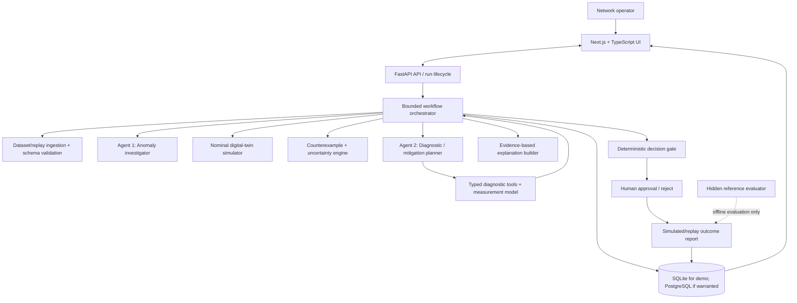

# FidelityGate — Final Architecture & Implementation Plan

**Counterexample-guided decision assurance for agentic network operations**  
**Primary CGI business domain:** IT Infrastructure  
**Primary workflow:** human-approved network reroute assurance during a traffic surge  
**Status:** final plan; items labelled *implemented*, *planned*, *demo-only*, or *unverified* must match evidence from the canonical repository.

> **Core principle:** Agents investigate and recommend. Deterministic code calculates and enforces. The reference evaluator measures. A human authorizes consequential changes.

This README reconciles the current FidelityGate Python core, the uploaded Next.js frontend archive, the teammate's architecture proposal, and the hackathon requirements. It deliberately separates the feasible hackathon MVP from future enterprise architecture. It is not a claim that every component below already exists or has been verified.

---

## 1. Executive decisions

| Question | Final decision | Reason |
|---|---|---|
| Can the Next.js frontend integrate with Python? | **Yes.** Keep Next.js/TypeScript and expose one stable backend API. | The frontend already has App Router pages/components and a Python CLI bridge, but request contracts currently mismatch in important places. |
| Should the app use explainable AI (XAI)? | **Yes: an evidence-based explanation layer, not another LLM that invents explanations.** | Explanations should be tied to actual observations, counterexamples, sensitivity calculations, and gate rules. |
| Do we need multiple agents? | **Use two bounded specialist agents at most for the MVP, coordinated by one orchestrator.** | There is enough role separation to be meaningful without a swarm of agents. If live LLM quota fails, preserve truthful deterministic fallback behavior. |
| Should every data-fetch layer get its own agent? | **No.** Parallelize independent I/O with orchestrator-controlled async tasks; use agents only when adaptive reasoning is needed. | Agents should reason, not act as expensive wrappers around HTTP calls. Concurrency, retries, deadlines and budgets belong to the orchestrator. |
| Should dummy data be replaced? | **Replace fabricated telemetry and dashboard KPIs with documented public replay data where appropriate, but retain controlled fault injection for reproducible ground truth.** | Public telemetry rarely contains aligned topology, capacities, measurement errors, interventions and verified outcomes for one identical network. A carefully labelled hybrid is more defensible. |
| Should we build a trained GNN? | **Not for the core demo.** | No verified trained model plus validated labels and evaluation is included in the supplied frontend archive. Training would create risk without establishing the core contribution. |
| Should we use HPC? | **No. Profile first.** Use bounded CPU computation, vectorization and controlled parallelism only if measured bottlenecks justify them. | The current small graph/parameter-sweep workload is not inherently an HPC workload. |
| Should we use Kafka, RabbitMQ, Redis, PostgreSQL, S3 all at once? | **No.** Start with FastAPI, SQLite or PostgreSQL, and bounded in-process tasks. Add infrastructure only for a defined need. | Avoid turning an applied decision-assurance prototype into unfinished infrastructure plumbing. |
| Can the decision action alter a real network? | **No, not in the hackathon MVP.** Run in an isolated simulation/replay environment and stop at a human-approved proposed action unless an authorized safe adapter actually exists. | Never imply production execution or physical network integration when none has been implemented and verified. |

## 2. Problem statement and contribution

Network-operations engineers must respond to congestion, link failures, latency drift and other anomalies while respecting service-level objectives (SLOs). An AI agent can propose a route that looks acceptable under a nominal digital-twin estimate but becomes infeasible when capacity, latency or traffic assumptions are wrong.

FidelityGate investigates this failure. It compares candidate interventions, searches a declared uncertainty envelope for counterexamples, identifies what assumption caused fragility, requests a targeted diagnostic when useful, recalculates the candidate, and sends the evidence to a deterministic gate.

### Research question

> Can counterexample-guided, agent-selected diagnostics improve decision quality or reduce diagnostic cost compared with nominal-only decisions, fixed safety margins and non-adaptive uncertainty sweeps?

This is a hypothesis to evaluate—not an established result or a claim of global novelty.

### Intended business workflow

**Data ingestion → anomaly triage → agentic investigation → candidate mitigation → isolated digital-twin evaluation → independent decision gate → human approval → outcome reporting.**

The primary domain is **IT Infrastructure**. Treat telecom/network operations as the scenario, not as a claim of production deployment. The solution aligns conceptually with ETSI ZSM work on digital twins and agent-based network management, TM Forum's Autonomous Networks work, and NIST's AI risk/explainability guidance. These are references, not certifications or endorsements.

## 3. What is in the supplied repository, and what must be fixed first

The uploaded frontend archive contains a Next.js 14 App Router / React / TypeScript application, Tailwind CSS, Recharts, Three.js, a Python `fidelitygate` package, a Python CLI bridge, SQLite database, an additional Express server, tests, and generated build/dependency artifacts. This is not yet a clean single-backend architecture.

### Confirmed concerns from the archive review

| Priority | Finding | Required correction |
|---|---|---|
| **P0** | `src/components/workspace/WorkspaceApp.tsx` calls `/api/investigate?scenario=...` using GET, but `src/app/api/investigate/route.ts` expects POST JSON with `scenario_key`. | Align path, HTTP method, request schema and response schema. Add contract tests. |
| **P0** | The UI calls `/api/adaptive-investigation?scenario=...`, while the route in the archive is `/api/adaptive-investigate` and expects POST JSON. | Pick one canonical route and update all callers. |
| **P0** | UI catch blocks create local fallback investigations with fabricated-looking measurements/trace events; the baseline fetch fallback contains hard-coded benchmark rows. | Remove silent fake-success fallbacks. On backend failure show a clear error and retain no false success state. Any fixture mode must be explicitly labelled `DEMO FIXTURE` and must not be mixed with live evaluation. |
| **P0** | Workspace/landing code contains illustrative global statistics such as `1,402` nodes, `18.4 ms`, `450 GB/s`, and regional compute loads. | Replace them with values from the selected scenario/backend. If retained for visual illustration, label each field as illustrative and never use it as a real network measurement. |
| **P0** | `src/app/api/*` handlers invoke the Python CLI via subprocess. An Express API server also exists, while `start-dev.js` references a `client` directory and port 5173 that do not match the root Next.js app layout in the archive. | Choose one canonical API path and one documented startup command. Prefer FastAPI as the long-lived backend; make Next.js call it. Retain Python CLI for offline benchmark/test execution, not as a second, competing API implementation. If time does not permit this migration, explicitly document the CLI bridge as the temporary local MVP and remove/disable the duplicate Express server. |
| **P1** | The README and UI copy call several parts “production”, “live telemetry”, or “physical” despite documented synthetic/replay operation. | Audit copy. Display `PUBLIC DATA REPLAY`, `SYNTHETIC INJECTION`, `SIMULATION`, `LIVE LLM`, and `DETERMINISTIC BASELINE` accurately. |
| **P1** | The ZIP contains `.next`, `node_modules`, and a SQLite DB. | Do not commit/share generated dependencies or local mutable database contents. Exclude `.next/`, `node_modules/`, local DBs, `.env`, logs, and caches from Git and ZIP exports. Keep `.env.example` only. Rotate any real secret if one was included in an untrusted bundle. |

**Important:** this was a source/archive inspection, not a successful end-to-end run of the uploaded frontend. Re-run checks in the actual development environment after corrections.

## 4. Final architecture

### Hackathon MVP — simple, defensible, integratable



The reference evaluator is an offline scoring boundary. It must not be an input tool available to agents. The `XAI` block explains the actual processing path and evidence; it is not allowed to alter the gate result.

### Target component responsibilities

1. **Next.js frontend:** decision workspace, topology, selected dataset/scenario, live trace, evidence inspector, evaluation lab, human approval screen. The UI does not compute the official gate decision.
2. **FastAPI:** validate requests/responses with Pydantic; expose runs/scenarios/events/evaluations; own API errors and run lifecycle.
3. **Orchestrator:** state machine, concurrency limits, deadlines, budgets, cancellation, retries, correlation IDs, idempotency and legal transition enforcement.
4. **Agent 1 — Anomaly Investigator:** reads normalized telemetry and topology summary; classifies a known anomaly or reports uncertainty; returns evidence IDs and missing data, not an action approval.
5. **Agent 2 — Diagnostic & Mitigation Planner:** receives the candidate, counterexample and evidence gaps; selects from a finite, validated shortlist of diagnostics and candidate mitigations. Cannot read hidden truth or override policy.
6. **Deterministic simulator:** calculate connectivity, load/utilization, latency approximation and SLO outcomes from a declared model.
7. **Counterexample/uncertainty engine:** test the candidate across a bounded, versioned uncertainty envelope; record the actual parameter vector and failed constraint for each counterexample.
8. **Diagnostic measurement layer:** produce an observation via a declared measurement-error model; update only the parameter(s) that measurement actually informs.
9. **XAI/explanation builder:** construct structured explanations from trace, evidence, math, sensitivity and gate predicates.
10. **Deterministic gate:** accept, request evidence or abstain. The LLM/GNN/XAI cannot override it.
11. **Reference evaluator:** access hidden synthetic truth only after the method has committed its decision; score unsafe acceptance, correct decisions, false abstentions and costs.
12. **Persistence:** runs, observations, candidate actions, model versions, simulation reports, gate decisions and audit events.

## 5. Multi-agent and concurrency strategy

Use **two bounded specialist agents**, not one LLM agent per data layer.

### Agent 1 — Anomaly Investigator

- **Input:** normalized event/telemetry window, data provenance, topology snapshot and SLO.
- **Output:** anomaly hypothesis, severity/class, evidence IDs, uncertainty and missing data.
- **Tools:** read-only metric/trace/topology queries and dataset search.
- **Forbidden:** direct action execution, gate decision, reference evaluator access.
- **Completion:** enough structured evidence to create candidate investigation, or explicit `INSUFFICIENT_EVIDENCE`.

### Agent 2 — Diagnostic & Mitigation Planner

- **Input:** candidate set, nominal prediction, counterexample, current uncertainty report and available diagnostic catalog.
- **Output:** ranked candidate probe(s), expected parameter relevance, rationale, estimated resource cost and next step.
- **Tools:** validated diagnostic registry and isolated candidate simulation.
- **Forbidden:** inventing observations, changing measurement error bounds, modifying gate thresholds or accessing hidden ground truth.
- **Completion:** choose a permitted probe, recommend re-evaluation, or report `NO_USEFUL_PROBE`.

### What should be parallel?

Independent **read-only I/O**, such as fetching multiple metrics, retrieving scenario metadata and reading the relevant topology, may run concurrently under orchestrator control. Use bounded async tasks/semaphores, per-call timeouts and clear partial-failure handling. The agents do not manage concurrency themselves.

Do not parallelize state-changing operations. Serialize diagnostic state updates and final gate decisions for a run. Use `run_id`, `scenario_version`, `evidence_version`, idempotency keys and an event sequence number to prevent stale or duplicate decisions.

### When would we add a third agent?

Only if an experiment establishes a need. A separate reporting/explanation LLM is not required: use deterministic evidence templates and an optional LLM to phrase a summary from the structured explanation object. Keep the summary non-authoritative. A GNN/model service is also not an LLM agent.

If API quota fails, the two LLM roles may fall back to **explicit deterministic baseline mode**; never show a fallback heuristic as an LLM-selected decision.

## 6. Explainable AI: include it, but implement it correctly

FidelityGate needs an explanation layer because the operator should understand not only the verdict, but the evidence and model assumptions that produced it. Do **not** add another free-form LLM that claims to explain the gate.

### Required explanation object

Every decision should be accompanied by structured fields:

- `decision_id`, `run_id`, `scenario_id`, `model_version`, `policy_version`
- candidate/action ID and exact candidate parameters
- evidence IDs and each evidence source, timestamp, unit, freshness and error bound
- nominal prediction versus SLO
- counterexample parameter vector and violated predicate
- variation range and number of evaluated cases
- which links/parameters contributed to the violation
- before/after uncertainty ranges following a diagnostic
- gate rule-by-rule pass/fail output
- why additional evidence was or was not available
- system knowledge limits and a plain-language summary grounded in these facts

### Feasible explainability methods

1. **Rule explanations:** for each gate predicate, show observed value, required threshold and the comparison (e.g. `utilization 1.08 > limit 1.00`).
2. **Counterexample replay:** show the exact perturbation that made a candidate violate the SLO.
3. **Local sensitivity:** vary one parameter at a time near the boundary, or compare a candidate with/without a relevant link/load perturbation. State that this is local sensitivity, not causal proof.
4. **Route/edge contribution:** recompute the route with a link removed or one parameter restored to nominal and measure the latency/feasibility difference. Label as counterfactual simulation.
5. **Feature-level anomaly rationale:** show source metric, baseline window, threshold, deviation and timestamp. If using a detector, use an appropriate explainer for that detector and validate the explanation fidelity.
6. **LLM explanation:** optional wording only, generated from structured facts. Do not use the prose as the evidence source.

For the MVP, no SHAP library or trained GNN is needed. SHAP or model-specific explainers become relevant only if a trained predictive model is actually added. Never claim SHAP explains an LLM's reasoning.

Map the explanation design conceptually to NISTIR 8312's principles: explanation, meaningfulness, explanation accuracy, and knowledge limits. This is alignment to guidance, not certification: https://doi.org/10.6028/NIST.IR.8312

## 7. Data strategy — replace fake metrics, not controlled ground truth

### Recommendation: hybrid real-data replay + controlled fault injection

Yes, remove arbitrary, hard-coded operational-looking values from the main workspace. But do not remove all synthetic data: exact ground truth for the decision-assurance experiment is needed, and public telemetry datasets usually do not provide a complete synchronized tuple of topology, per-link capacity, traffic, model error, candidate action and post-action outcome.

Use three layers and label them visibly:

1. **Public telemetry replay** — real published data used for anomaly context and evidence.
2. **Versioned topology/traffic substrate** — a documented topology plus traffic values where the sources really correspond; don't pretend unrelated datasets represent one network.
3. **Controlled fault injection** — synthetic congestion, latency drift, link failure and measurement noise with known injection schedule, used to establish test ground truth for the simulation.

### Suggested sources

#### Primary anomaly dataset: Cisco Innovation Edge telemetry
https://github.com/cisco-ie/telemetry

The repository describes open datasets for network anomaly research. Each dataset includes CSV telemetry, header definitions and case files, plus topology documentation. Published cases include baseline periods and events such as BGP clears, port flaps, port admin shutdowns, and transceiver removal/reinsertion. Its license file identifies the Community Data License Agreement — Permissive 1.0 (CDLA-Permissive-1.0). Review the repository and license before redistribution.

**Use it for:** a real anomaly-replay/triage path, source telemetry examples and anomaly/event labels where the dataset's case file provides them.

**Do not claim:** every Cisco trace directly provides route-by-route latency, actual residual capacity, diagnostic measurement error, and action outcome. Inspect field definitions and availability before mapping a field into the digital twin.

#### Optional topology source: Internet Topology Zoo
https://topology-zoo.org/dataset.html

Contains network graph topologies traced from operator-provided network maps. It can supply a documented graph for testing graph ingestion. Some topologies are historical, and topology alone does not provide aligned live telemetry or anomaly ground truth.

**Do not combine a Cisco telemetry trace and an unrelated Zoo topology as though they came from the same physical network.** If using separate sources, label the pairing as a representative simulation, not a real network replay.

#### Optional Abilene time-series dataset
https://cesnet.github.io/cesnet-tszoo/datasets_overview/

CESNET TS-Zoo describes Abilene traffic-matrix data collected from the historical Internet2 Abilene network. This may provide realistic traffic variation, but it is not by itself a complete labeled routing-intervention benchmark. Verify units, mapping, version, license and whether the topology is compatible before using it.

### Data ingestion pipeline

`Source adapter → parse CSV/case file → canonical schema → validate units/timestamps/duplicates/missingness → record provenance → map metrics → anomaly triage → candidate investigation`.

Canonical observation example:

```json
{
  "observation_id": "obs_generated_by_app",
  "source_dataset": "cisco-ie/telemetry",
  "source_file": "relative/path/from_dataset",
  "event_id": "case_file_event_if_available",
  "timestamp": "source_timestamp_if_available",
  "metric": "actual_header_name",
  "value": 0.0,
  "unit": "documented_unit",
  "quality": "OBSERVED_OR_UNKNOWN",
  "provenance": "dataset_version_and_row_reference"
}
```

Values in this schema illustration are placeholders, not real data. Never infer a unit or event label if the dataset does not document it.

### What should still be synthetic?

Keep synthetic data for model parameters not available in the real dataset (e.g., route-action outcome, controlled measurement-error bounds or hidden reference capacity), and for injected failures where the exact ground truth must be known. Record the injected parameter and schedule in the evaluator-only scenario definition.

Use a strict separation:

- agent-readable telemetry and observations;
- nominal-model parameters;
- declared uncertainty envelope;
- evaluator-only ground truth and injection schedule.

For any demo screen, label each value as `PUBLIC REPLAY`, `SYNTHETIC INJECTION`, `SIMULATED`, or `LIVE`.

## 8. Anomaly detection choice and training

FidelityGate is primarily a decision-assurance system, not a new anomaly detector. Don't let model training take over the project.

### MVP detector

Start with the dataset's documented event/case labels for replay evaluation, plus a transparent statistical triage baseline for unlabelled windows. One reasonable baseline is a rolling median/MAD deviation score or a simple threshold/rule detector using correctly defined fields. Use a model only if it has a clear feature schema and verified evaluation.

### Optional trained model

Do **not** claim that a GNN exists in the current application unless an actual trained artifact, data preprocessing, training script, model version, metrics and limitations are present. The frontend archive's product copy mentions graph intelligence, but the inspected archive does not by itself prove a trained/evaluated GNN is wired into the Python core.

A GNN is a future experiment only if there are sufficient labelled graphs/time windows and a meaningful comparison with simpler baselines. Train/validation/test splits must avoid temporal and topology leakage. Report class imbalance and precision-recall metrics, not accuracy alone.

### Why not HPC?

The current problem uses small graph scenarios and bounded parameter sweeps. Start with ordinary CPU execution, profile, then optimize. Use vectorization or bounded parallelism for independent candidate evaluations if the timing measurements justify it. HPC/GPU/distributed compute becomes relevant only after a measured workload demonstrates the need. Do not use “HPC-powered” as marketing language without evidence.

## 9. Digital twin, uncertainty and gate mathematics

Let the network be a graph `G=(V,E)`. For each link `e`, define capacity `C_e`, base latency `d_e`, background load `b_e`; for each flow `k`, demand `q_k` and path indicator `x_ke`.

Link load and utilization:

`B_e = b_e + Σ_k q_k x_ke`  
`ρ_e = B_e / C_e`

A candidate is feasible only if the required path is connected, each enforced utilization/capacity constraint passes and the path latency satisfies its SLO. The simulator's latency formula is a simplified queueing-inspired approximation and must be documented as such; it is not a fully calibrated telecom model.

Let `θ` be uncertain parameters and `Θ` the declared uncertainty envelope. The counterexample engine searches for:

`θ_c ∈ Θ such that Feasible(action, θ_c) = False`.

For a finite sweep of `N` tested parameter settings, define `v_i=1` if any required constraint fails, else `0`. The sampled violation fraction is `r_hat = Σv_i / N`; sampled feasibility is `1-r_hat`.

**Do not call this fraction a real-world probability of failure** unless the sampling distribution is justified. Finite perturbation sweeps provide evidence over tested samples, not a proof over every continuous value in `Θ`.

### Diagnostic measurement update

A diagnostic should follow a declared observation model such as `y = h_d(θ*) + ε`, with units and bounded/statistical error justified by the scenario. Update only the parameter interval informed by that observation. Do not expose evaluator ground truth as the measurement. If the new interval conflicts with existing assumptions, record the inconsistency and seek more evidence or abstain.

### Decision gate

- `ACCEPT`: all mandatory constraints and the configured robustness criteria pass using valid current evidence.
- `GATHER_EVIDENCE`: a decision-relevant uncertainty remains and a permitted diagnostic may reduce it within the run budget.
- `ABSTAIN`: no candidate is justified, required evidence is unavailable, model constraints fail, or limits are exhausted.

The gate outcome must be calculated by backend deterministic code, not by the LLM, frontend or explanation layer.

## 10. Orchestration, parallelism and XAI flow

### Run state machine

`RECEIVED → VALIDATING → TRIAGING → INVESTIGATING → CANDIDATE_EVALUATION → COUNTEREXAMPLE_SEARCH → DIAGNOSTIC_SELECTION → MEASUREMENT → REEVALUATION → GATE_REVIEW → AWAITING_HUMAN_APPROVAL → SIMULATED/AUTHORIZED_ACTION (only if implemented) → OUTCOME_REPORT`

Terminal alternatives: `ABSTAINED`, `REJECTED`, `FAILED`, `TIMED_OUT`, `CANCELLED`, `NEEDS_OPERATOR_INPUT`.

### Concurrency rules

- Orchestrator dispatches only independent, read-only fetches concurrently.
- Use a bounded semaphore, timeouts, cancellation and per-source partial failure reporting.
- Serialize evidence updates and gate decisions for a run.
- Use run/version IDs and idempotency to avoid duplicate processing.
- Do not use Kafka/RabbitMQ for the MVP. If the workflow later needs a durable distributed queue, choose one based on requirements and measured throughput.

### XAI trace per run

Store and display: observation and provenance → agent/tool decision → candidate → nominal result → counterexample parameters → diagnostic selection rationale → observation/error bounds → revised uncertainty → rule-by-rule gate result → reference score (post-hoc only). The text explanation must be derived from these records. An optional language model may summarize the structured explanation, but cannot change the recorded cause or official decision.

## 11. Frontend integration plan

### Keep

- Next.js App Router, TypeScript, Tailwind, Recharts, and the current responsive workspace structure.
- The visual style inspired by BilloDesign, including the restrained 3D network motif if it remains performant.
- Existing components that are actually wired to real data and pass build/browser verification.

### Fix before new features

1. Make UI request paths and methods match API route definitions.
2. Use one canonical backend API boundary. **Target:** FastAPI is the business API and long-lived Python runtime; Next.js calls FastAPI with typed JSON contracts. The Python CLI remains useful for offline evaluation and smoke tests. Do not simultaneously maintain a duplicate Express API and Next.js Python-subprocess API.
3. If migrating to FastAPI cannot be completed safely before the event, use the existing Next.js API route + Python CLI bridge as an explicitly temporary local design, fix contracts, disable/remove the unused Express startup path, and avoid concurrent subprocess calls that contend for shared state.
4. Remove silent mock-success fallbacks. An API failure must produce an explicit error/empty state, not a fabricated counterexample, measurement, trace or benchmark.
5. Remove or label hard-coded global statistics (node count, throughput, latency, regional compute loads). Main workspace numbers must be populated from the selected scenario/backend.
6. Clearly label public replay versus synthetic simulation versus live provider mode.
7. Keep `SPLINE`/Three.js visuals decorative and non-authoritative. The topology graph, candidate paths and metrics must be generated from the actual scenario data.
8. Add an approval modal only for actions the application can actually enact or simulate. If no action executor exists, the button must say “Review proposal” / “Approve simulated intervention”, not “Deploy reroute”.

### API contract sketch

- `GET /api/v1/health`
- `GET /api/v1/scenarios`
- `POST /api/v1/runs`
- `GET /api/v1/runs/{run_id}`
- `GET /api/v1/runs/{run_id}/events`
- `GET /api/v1/evaluations/{evaluation_id}`
- `POST /api/v1/evaluations`
- `POST /api/v1/runs/{run_id}/approval` only if authenticated approval is genuinely implemented

Treat these endpoints as the target contract; do not claim they already exist until implemented. Define Pydantic request/response models and mirror them with TypeScript types generated from OpenAPI or contract tests.

## 12. Evaluation plan

Compare four approaches on the same scenario set and equivalent initial information:

1. **Nominal-only:** select using nominal predictions.
2. **Fixed safety margin:** apply a predetermined margin to stated constraints.
3. **Non-adaptive sweep:** evaluate the same declared parameter envelope without targeted new measurement.
4. **FidelityGate:** identify counterexample, select diagnostic, update the appropriate uncertainty and reevaluate.

### Primary metrics

- **Unsafe acceptance frequency:** unsafe accepted scenarios / all scenarios.
- **Unsafe acceptance rate among accepted decisions:** unsafe accepted scenarios / accepted scenarios; report `N/A` when no candidates are accepted.
- Correct acceptance rate and correct abstention rate.
- False-abstention rate among scenarios where at least one candidate is safe under the evaluation definition.
- Diagnostic calls per scenario.
- Numerical simulator evaluations per scenario.
- Wall-clock latency.
- Fraction of runs where measurement changes the chosen action or changes an inconclusive decision into a supported decision.
- Data/anomaly detector metrics only if a detection model is genuinely evaluated: precision, recall, F1 and average detection delay, with event-level definitions.

Use identical scenario seeds, frozen thresholds, documented fault schedules and an isolated reference evaluator. Keep a development set and a held-out evaluation set where feasible. The prototype's small dataset supports a proof-of-concept, not a statistical or production-safety guarantee.

### Mandatory scenarios

- Nominal candidate is genuinely safe.
- Nominally attractive candidate fails under a hidden/reference capacity or latency mismatch.
- One relevant measurement resolves the decision.
- Diagnostic is noisy/uninformative and must not create false confidence.
- No candidate is feasible, so the correct outcome is ABSTAIN.
- Unknown/unsupported anomaly or missing telemetry causes `NEEDS_OPERATOR_INPUT`/ABSTAIN.
- LLM provider fails or quota is exhausted; the UI truthfully reports baseline mode.

## 13. Reliability, security, responsible AI and human approval

- Typed schemas and allowlisted tools; no arbitrary Python, shell, SQL or network commands from the LLM.
- Least privilege and read-only collectors for the demo.
- Separate evaluator-only secret/state from agent-readable evidence.
- Schema/unit/timestamp/freshness/provenance checks at ingestion.
- Explicit limits for model calls, diagnostic calls, simulation evaluations, timeouts and retries.
- Circuit breaker and sanitized error reporting for provider failures.
- Idempotent run creation and safe cancellation.
- Persist all important state transitions and gate decisions.
- Human approval bound to a specific candidate and evidence version before consequential action.
- Invalidate approval if material evidence changes.
- No external network configuration changes in the MVP. Run interventions only in an isolated simulator/replay.
- Secrets remain in `.env` or a secrets manager, never in the ZIP, database seed data, frontend bundle or logs.

Industry-reference alignment:
- ETSI ZSM studies network digital twins and agent-based network/service management: https://www.etsi.org/technical-groups/zsm/
- TM Forum Autonomous Networks mission/framework focuses on moving from automation to intelligent, closed-loop network operations: https://www.tmforum.org/missions/autonomous-networks
- NISTIR 8312 describes explainability principles: https://doi.org/10.6028/NIST.IR.8312
- NIST AI RMF is a voluntary framework for managing AI risks: https://www.nist.gov/itl/ai-risk-management-framework

These are design references. FidelityGate is not certified compliant, endorsed by these bodies, or a production network product.

## 14. Deployment/runtime stack: MVP versus future

| Layer | Hackathon/MVP choice | Add only when justified |
|---|---|---|
| Frontend | Existing Next.js/TypeScript app | Further design system work only after data wiring passes |
| API | FastAPI as one business API; Python CLI for offline benchmark | API gateway/authn for production environments |
| Workflow | One orchestrator with bounded concurrent reads | Durable workflow engine only if runs need restart/resume across distributed workers |
| Database | SQLite for a single-machine demo, or PostgreSQL if already set up | Managed PostgreSQL for multi-user persistent operation |
| Cache | None by default | Redis after profiling shows cache/coordination need |
| Queue | None for small synchronous demo | One of RabbitMQ or Kafka after measured async workload need; not both by default |
| Object storage | Local versioned dataset fixtures | S3-compatible storage for large traces/artifacts |
| Graph ML | None unless a trained, evaluated model is available | GNN/GraphSAGE/etc. only with sufficient labeled data and an honest benchmark |
| Compute | Standard CPU, bounded sweep | Parallel/vectorized compute after profiling; HPC only if evidence shows it is needed |
| Observability | Structured logs, request/run IDs, simple counters and trace tables | OpenTelemetry/Prometheus/Grafana for sustained multi-service operation |
| Deployment | Local reproducible run; simple hosted components only if stable | Container orchestration only if operational requirements warrant it |

## 15. Immediate implementation roadmap

### P0 — integration and integrity (do first)

1. Decide the single backend/API boundary; write down the decision.
2. Fix the existing frontend API path/method/body mismatches.
3. Remove fabricated success fallbacks and hard-coded operational KPI values.
4. Verify the same selected scenario reaches the Python backend and its real result is rendered.
5. Fix dataset ingestion adapter and label the telemetry's provenance/mode.
6. Correct the measurement model so it doesn't expose hidden reference truth with an unrealistically exact reading.
7. Ensure no reference/evaluator information is accessible to the agents.
8. Run Python tests, TypeScript checks, production build and a browser end-to-end smoke test.

**P0 exit criterion:** one reproducible run works from dataset/scenario selection through actual tool calls, counterexample, diagnostic evidence, gate decision, and persisted outcome—with no fake fallback outputs.

### P1 — differentiate and prove value

- Two bounded agent roles with orchestrator-controlled concurrency.
- Evidence-based explanation layer tied to counterexample, measurement and gate predicates.
- Replay at least one documented public telemetry anomaly if field schema is compatible.
- Four-way evaluation on fixed scenarios.
- Show one fragility-rejection case and one appropriate ABSTAIN case.

### P2 — future expansion (not a blocker)

- GNN/anomaly model training after obtaining appropriate labeled data.
- Kafka/RabbitMQ, Redis, object storage, HPC/GPU.
- Real device SNMP/ICMP collection or route execution, only with authorization and a safe sandbox/approval process.
- Multi-tenant auth and production SLO monitoring.

## 16. Team ownership and AI-account coordination

- **Developer A — backend/research:** ingestion, normalized schema, simulator, counterexample engine, diagnostic error model, gate and evaluation harness.
- **Developer B — frontend/integration:** Next.js UI, topology, trace, evidence panel, FastAPI integration, clear data-mode states and end-to-end demo.
- **One integration owner:** merges work, freezes contracts, owns the final go/no-go and validates the whole run.

Additional Antigravity/ChatGPT sessions should be used as bounded specialist reviewers or on isolated files, not to independently rewrite the same core modules. Keep canonical context in repository docs:

- `docs/PROJECT_BRIEF.md`
- `docs/ARCHITECTURE.md`
- `docs/CONTRACTS.md`
- `docs/METHODOLOGY.md`
- `docs/EVALUATION_PROTOCOL.md`
- `docs/CURRENT_STATUS.md`
- `docs/HANDOFF.md`
- `docs/DECISIONS.md`

Require each assistant to report files changed, tests run, results and limitations. Don't assume chat history follows an account/model switch.

## 17. Definition of done

FidelityGate is ready to present only when:

- A documented public-data replay or clearly labelled synthetic scenario enters the same normalized ingestion path.
- A real agent run is clearly distinguished from deterministic baseline mode.
- Every displayed action/measurement in the trace corresponds to a persisted event.
- A computed counterexample shows which stated constraint fails and under which parameters.
- A diagnostic observation has a declared unit, provenance and error model and does not leak hidden reference truth.
- The uncertainty update is mathematically justified and only affects relevant parameters.
- The decision gate passes/fails on deterministic predicates and cannot be overridden by agent output.
- A human can approve or reject the specific proposal; no unimplemented real-world action is presented as executed.
- Baselines use the same scenarios and comparable information; actual metrics and denominators are displayed.
- Automated tests, build and browser workflow are actually run, with failures recorded honestly.

## 18. Sources

- Cisco Innovation Edge network telemetry anomaly datasets and case files (CDLA-Permissive-1.0 noted in repository): https://github.com/cisco-ie/telemetry
- Internet Topology Zoo graph datasets and documentation: https://topology-zoo.org/dataset.html
- CESNET TS-Zoo dataset overview including Abilene traffic-matrix data: https://cesnet.github.io/cesnet-tszoo/datasets_overview/
- ETSI Zero-touch network and Service Management (ZSM): https://www.etsi.org/technical-groups/zsm/
- TM Forum Autonomous Networks mission and maturity context: https://www.tmforum.org/missions/autonomous-networks
- NISTIR 8312, *Four Principles of Explainable Artificial Intelligence*: https://doi.org/10.6028/NIST.IR.8312
- NIST AI Risk Management Framework: https://www.nist.gov/itl/ai-risk-management-framework
- IETF Network Management Operations anomaly detection evaluation draft (informational/work-in-progress; review current status before citing as a standard): https://datatracker.ietf.org/doc/draft-anjum-nmop-anomaly-detection-evaluation/

---

## Final architecture ruling

Build **one integrated business workflow** in the IT Infrastructure domain. Use Next.js for the interface, FastAPI for the canonical API, Python for the simulator/uncertainty/gate, two bounded agent roles, orchestrator-owned concurrency, an evidence-grounded XAI layer, public telemetry replay plus controlled fault injection, and an independent evaluator.

Do not adopt a GNN, HPC, Kafka, Redis, multiple overlapping APIs, or a large multi-agent swarm unless a measured need appears. First eliminate the current mock-success/API-contract issues, then prove the data → decision → human approval → outcome reporting path end to end.
